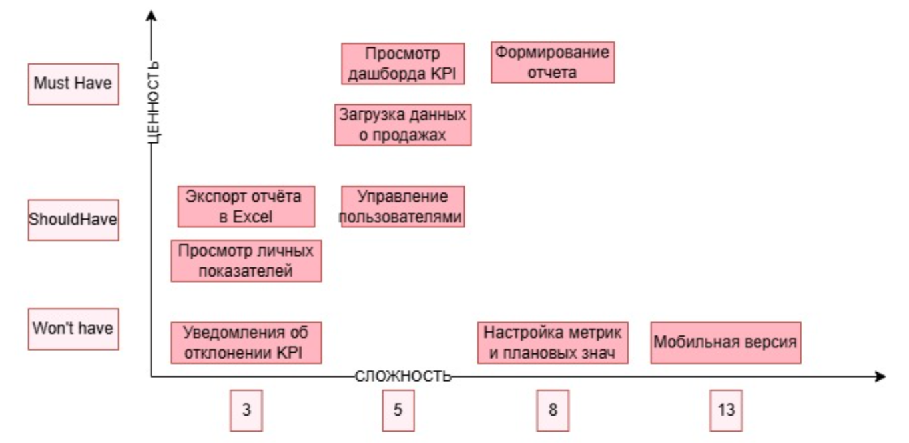

# Product Backlog – Business Metrics Analyzer

| ID | User Story | Приоритет (MoSCoW) | Story Points | Спринт | Статус |
|---|---|---|---|---|---|
| US-01 | Просмотр дашборда KPI | Must have | 5 | 1 | To Do |
| US-02 | Формирование отчета | Must have | 8 | 1 | To Do |
| US-03 | Загрузка данных о продажах | Must have | 5 | 1 | To Do |
| US-04 | Экспорт отчёта в Excel | Should have | 3 | 2 | To Do |
| US-05 | Управление пользователями и ролями | Should have | 5 | 2 | To Do |
| US-06 | Просмотр личных показателей менеджером | Should have | 3 | 2 | To Do |
| US-07 | Настройка метрик и плановых значений | Could have | 8 | 3 | To Do |
| US-08 | Уведомления об отклонении KPI | Could have | 3 | 3 | To Do |
| US-09 | Мобильная версия | Won't have | 13 | – | Отложено |

